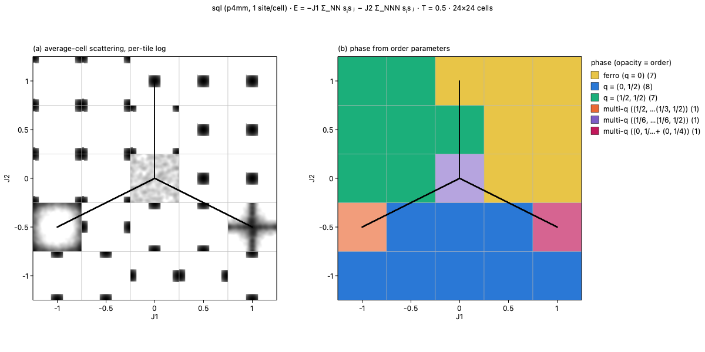

# Phase Tiles

Tiled Ising phase diagrams on any 2D net from the
[RCSR](http://rcsr.net). You choose a net, the couplings to vary and
a temperature. Each tile of the diagram is one Monte Carlo run, drawn
as its average-cell scattering folded into one Brillouin zone, so a
diagram shows both *which* phase forms and *where its Bragg peaks
are*. Click a tile to see its real-space domains.



*The J1–J2 Ising model on the square net (`sql`) at T = 0.5, from
the bundled sample project: (a) the scattering of each tile, (b) the
phase it is classified as. The black lines are the T = 0 phase
boundaries.*

## Features

- **Any 2D RCSR net.** All 199 plane nets are included (square,
  honeycomb, kagome, triangular, ...). Each net is expanded by its
  plane group.
- **Couplings by shell.** J1 couples the net's edges; J2, J3, ... up
  to J6 couple the next geometric distance shells. A field H is also
  available.
- **Tiles that fit together.** Each tile is a Wigner–Seitz cell on
  the reciprocal lattice, centred on Γ or on (½, ½).
- **Phases** are classified from order parameters, with the T = 0
  ground-state boundaries drawn over them.
- **Domains:** spins, orientation and antiphase maps for any tile.
- **Results are cached by what produced them** (net, Hamiltonian, MC
  settings, parameters). Changing the range, undoing or reopening a
  project reuses finished tiles, and display options never rerun MC.
- **Projects (`.phtiles`)** carry their tiles, so a diagram that took
  an hour opens instantly on another machine.
- **Export** to PNG, SVG or JPEG.
- **Headless core and CLI** for scripts, clusters and notebooks.

## Install

### App

Download the installer for your platform from the
[Releases](https://github.com/JulesOpp/Phase-Tiles/releases) page:

- macOS: `Phase-Tiles-<version>-arm64.dmg` (Apple silicon) or
  `-x86_64.dmg` (Intel)
- Windows: `Phase-Tiles-<version>-setup.exe`. It installs per user
  and needs no admin rights.

The builds are not code-signed. On macOS, the first launch is
blocked: open **System Settings → Privacy & Security** and click
**Open Anyway**. On Windows, choose **More info → Run anyway** in
SmartScreen.

### From source

Requires Python 3.11 or later.

```bash
git clone https://github.com/JulesOpp/Phase-Tiles.git
cd Phase-Tiles
python -m pip install -e ".[gui]"
phase-tiles
```

Without the `gui` extra you get only the core and the `phasetiles`
command, which need nothing but NumPy and SciPy.

## Command line

```bash
phasetiles nets                      # list the 199 2D nets
phasetiles info --net kgm            # a net's sites and shells
phasetiles run --net sql --vary J1=-1:1:0.1 --vary J2=-1:1:0.1 --fix T=0.5
phasetiles render --net sql --vary J1=-1:1:0.1 --vary J2=-1:1:0.1 \
    --fix T=0.5 --out diagram.png    # needs the gui extra
```

`--vary NAME=start:stop:step` sets the x axis, then the y axis.
`--fix NAME=value` sets any other parameter; give `T` here unless it
is on an axis. The MC
settings are `--n` (supercell size), `--anneal`, `--equil`,
`--snaps`, `--seed` and `--workers` (default 2). Results go to the
app's default cache, so the app shows tiles the CLI computed.

## Development

```bash
python -m pip install -e ".[gui,test]"
python -m pytest -q                  # everything
python -m pytest -q -m "not gui"     # core only, no display needed
ruff check .
```

`phasetiles/` is the physics and imports no Qt. `phasetilesapp/` is
the PySide6 interface. [CLAUDE.md](CLAUDE.md) lists the design
invariants. To build the installers:

```bash
python -m pip install -e ".[gui,build]"
pyinstaller --noconfirm packaging/macos.spec    # or windows.spec
```

CI builds both installers and self-tests them. Pushing a `v*` tag
creates a draft release with the installers attached.

## Credits and licence

Phase Tiles is released under the [MIT License](LICENSE).

The net data is a 2D extract of the Reticular Chemistry Structure
Resource ([rcsr.net](http://rcsr.net); see
[PROVENANCE.md](phasetiles/data/PROVENANCE.md)). If you use it,
please cite:

> M. O'Keeffe, M. A. Peskov, S. J. Ramsden and O. M. Yaghi, "The
> Reticular Chemistry Structure Resource (RCSR) Database of, and
> Symbols for, Crystal Nets", *Acc. Chem. Res.* **41**, 1782–1789
> (2008). doi:10.1021/ar800124u

The installers also contain Python, NumPy, SciPy and Qt for Python
(LGPL-3.0). Their licences are in the app's `licenses` folder; see
[THIRD-PARTY-NOTICES.txt](packaging/licenses/THIRD-PARTY-NOTICES.txt).
